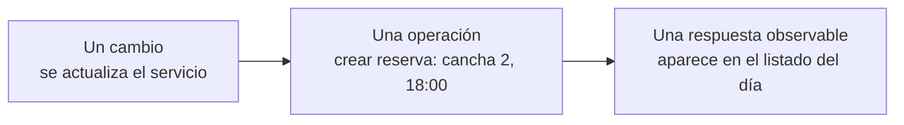
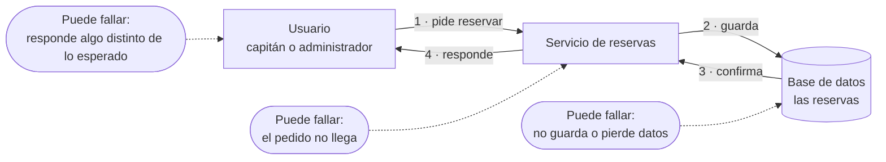
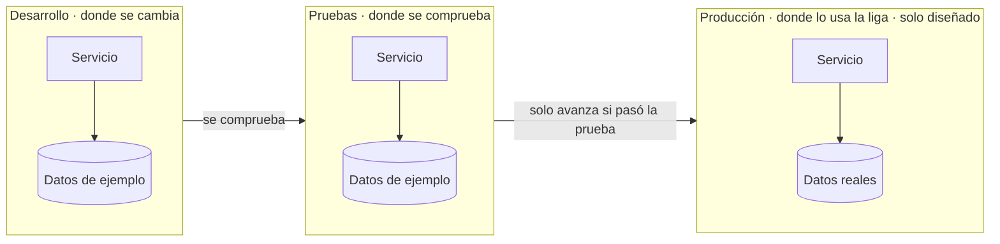
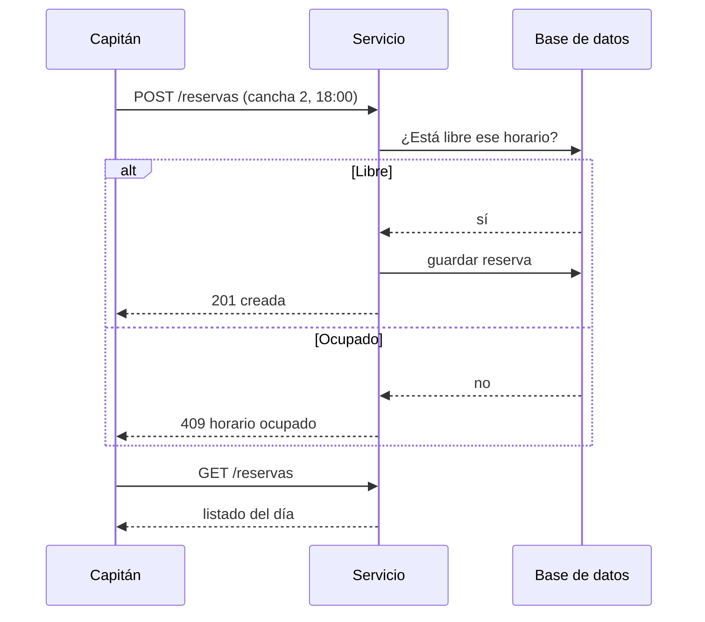

# reservas-canchas

Reservas de canchas de fútbol 5 para ligas de barrio.

**Versión del README:** 0.2 · **Autoría:** nombre y apellido · **Última revisión:** fecha

---

## 1. Qué es y para quién

Un servicio pequeño para reservar una cancha en una hora determinada y ver las reservas del día.

- **Ámbito:** deporte barrial, ligas de fútbol 5.
- **Quién lo usa:** capitanes de equipo (reservan) y el administrador de la liga (revisa el día).
- **Quién no lo usa:** los jugadores. Ellos reciben la información por su capitán, no entran al servicio.
- **Qué necesita poder hacer quien lo usa:** reservar sin chocar con otro equipo y saber con certeza que su reserva quedó registrada.

## 2. Qué puede fallar

| Cuando cambia… | Qué deja de funcionar | Quién lo nota | Cómo se entera hoy |
|---|---|---|---|
| El servicio se actualiza | No se pueden crear reservas | Los capitanes, el sábado al llegar a la cancha | Cuando alguien reclama |
| Se mueve o se pierde la lista de reservas | El administrador ve un día vacío | El administrador | Al abrir el listado |
| Dos equipos piden la misma hora | Se acepta una doble reserva | Ambos equipos, en la cancha | Cuando se encuentran |

## 3. El servicio pequeño

El más chico que representa el problema: **reservar una cancha** y **ver las reservas del día**.

- **Qué entra:** 3 canchas, horas en punto entre las 08:00 y las 21:00.
- **Operación que muestra su valor:** crear una reserva, por ejemplo cancha 2 a las 18:00.
- **Respuesta observable:** la reserva se crea y aparece en el listado del día.
- **Si el horario ya está ocupado:** el servicio lo rechaza y lo dice con claridad.
- **Por qué es una muestra válida:** contiene lo que más duele si falla (reservar) y lo que permite verificarlo (listar). El resto de la liga puede esperar.

## 4. Recorrido mínimo

1. **Un cambio:** se actualiza el servicio de reservas.
2. **Una operación:** crear una reserva, cancha 2 a las 18:00.
3. **Una respuesta observable:** la reserva se crea y aparece en el listado.

## 5. Arquitectura inicial

| Pieza | Qué es | Para qué sirve |
|---|---|---|
| Servicio de reservas | La aplicación | Recibe pedidos y responde |
| Base de datos | Dependencia | Guarda las reservas: ahí vive lo importante |
| Usuario | Quien hace el pedido | Capitán o administrador |

**Entornos:** desarrollo (donde se cambia), pruebas (donde se comprueba) y producción (donde lo usan las personas de la liga).
**Qué varía entre entornos:** la configuración, el acceso y los datos. En producción los datos son reales y el acceso es más restringido; por eso aquí **solo se diseña**: no se ejecuta ni se toca con datos reales.
**Qué se conserva:** lo que el usuario espera: crear, listar y rechazar un horario ocupado.
**Dónde podría fallar una petición:** al llegar al servicio, al guardar en la base de datos o al responder.

Los tres entornos comparten el mismo recorrido y cambian solo lo que varía. Una versión solo avanza hacia producción si pasó la comprobación del entorno anterior:

## 6. Criterios de aceptación

| # | Operación | Evidencia |
|---|---|---|
| 1 | Crear una reserva, cancha 2 a las 18:00 | Otra persona obtiene el mismo resultado, con la versión y la entrada anotadas |
| 2 | Un cambio que deja el servicio sin poder reservar | La versión no avanza, o se vuelve a la anterior y la operación funciona de nuevo |

## 7. Pruebas de aceptación

**Prueba A · se ejecuta**
- Entrada: crear una reserva, cancha 2 a las 18:00.
- Se espera: la reserva se crea y aparece en el listado.
- Cómo se comprueba: se hace el pedido y se mira el listado.

**Prueba B · solo se analiza**
- Entrada: pedir un horario que ya está ocupado.
- Se espera: el servicio lo rechaza y no duplica la reserva.
- Cómo se comprueba: se revisa el diseño; todavía no se ejecuta.

## 8. Alcance

**Incluido (la cadena pequeña que sí se ejecuta)**
- Crear una reserva.
- Ver las reservas del día.
- Rechazar un horario ocupado.

**Excluido (escrito para no perder el foco)**
- **Pagos:** hoy no cambian el problema de fondo. Primero que reservar funcione, luego cobrar.
- **Notificaciones:** avisar al equipo es valioso, pero no hace falta para saber si reservar funciona.
- **Cuentas de usuario y panel del administrador:** requieren decisiones de acceso que todavía no tomamos.
- **Operar producción con datos reales y varios proveedores:** producción se diseña en el diagrama, pero no se ejecuta. Una sola cadena completa primero.

## 9. Qué queda para después

Las ampliaciones esperan a tener una primera cadena completa. En orden de prioridad:

1. Revisar que el listado coincida con una muestra de reservas de ejemplo.
2. Definir cómo avisar a los equipos cuando una reserva cambia.
3. Pensar en el cobro de la cancha.

## 10. Qué está comprobado y qué no

| Afirmación | Estado |
|---|---|
| Crear una reserva, cancha 2 a las 18:00, devuelve éxito con la versión 1.4.0 | **ejecutado** |
| El listado del día coincide con 20 reservas de ejemplo | **comprobado con muestra** |
| Un horario ocupado se rechaza sin duplicar | **solo diseñado** |
| Volver a la versión anterior si un cambio falla | **solo diseñado** |
| Una versión solo llega a producción si pasó las pruebas | **solo diseñado** |

## 11. Recursos y accesos

- **Con qué cuento:** un computador y datos de ejemplo, ficticios. Sin cuenta en la nube.
- **Qué no tengo:** datos reales de ninguna liga ni acceso a sistemas de una empresa.
- **Qué operación del caso real quedaría sin comprobar:** el comportamiento con reservas reales y varios capitanes a la vez.

## 12. Quién cambia, quién aprueba, quién observa

| Rol | Quién |
|---|---|
| Quién cambia el servicio | La persona que mantiene el proyecto |
| Quién aprueba que una versión avance a pruebas y luego a producción | La misma persona, tras revisar la prueba A. El administrador de la liga confirma antes de pasar a producción |
| Quién observa si funcionó | El administrador de la liga, mirando el listado |

## 13. Aportes

Si trabajas con otras personas: quién hizo qué y qué dependencia explicó cada una. Cada quien conserva su proyecto; no hay equipos fijos.

| Persona | Aporte visible |
|---|---|
| Nombre | Qué hizo y qué se ve de eso |

## 14. Bosquejo técnico (opcional)

> **Solo si ya avanzaste.** Si no sabes qué significa algo de aquí, sáltate la sección: el README ya está completo sin ella. No necesitas herramientas para escribirla.

El mismo recorrido, visto a nivel de pedidos al servicio:

| Pedido | Qué hace | Respuesta esperada |
|---|---|---|
| `GET /reservas` | Lista las reservas del día | Lista de reservas |
| `POST /reservas` | Crea una reserva | 201 si se crea · 400 si el pedido es inválido · 409 si el horario está ocupado |
| `DELETE /reservas` | Cancela una reserva | Confirmación |
| `GET /salud` | Indica si el servicio responde | Respuesta de que está activo |

Lo que este bosquejo **no** incluye todavía, a propósito: cómo se empaqueta, cómo se configura, cómo se valida automáticamente y cómo se despliega. Llegan en los siguientes encuentros.

## 15. Cómo leer este README

Una persona que no conoce el proyecto debería poder responder, sin preguntarle a quien lo escribió:

1. ¿Quién tiene este problema y quién no?
2. ¿Qué operación muestra que el servicio sirve?
3. ¿Qué se comprobó de verdad y qué solo se diseñó?
4. ¿Qué quedó fuera y por qué?
